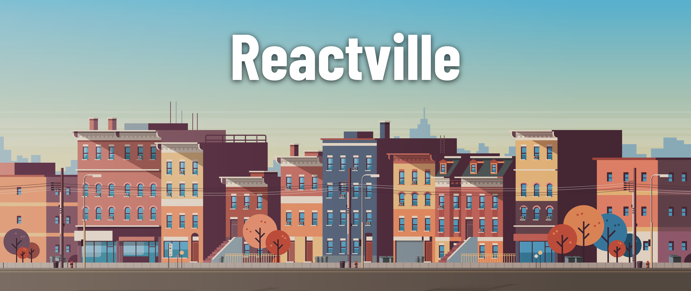
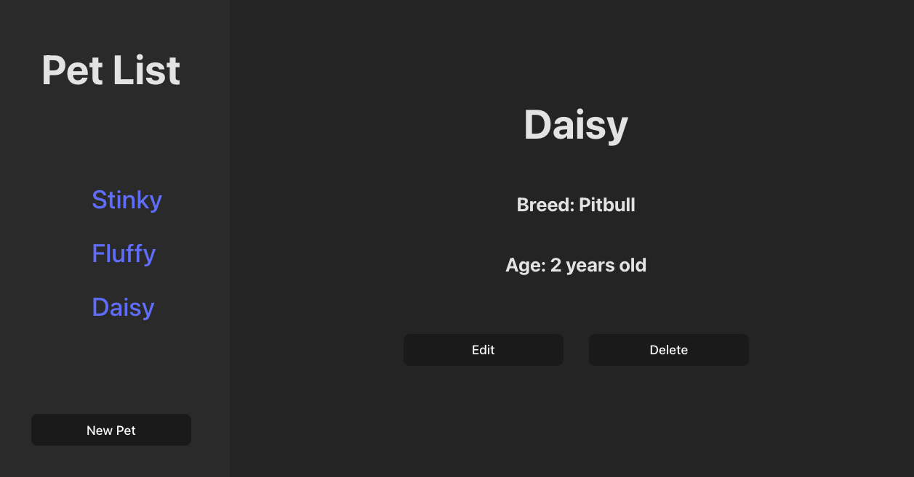

# 

Welcome to Reactville, a constantly evolving virtual metropolis. Let's build this digital town together, one component at a time.

## About

The Reactville animal shelter is looking for a solution for keeping track of all the animals they have currently listed for adoption. You're going to help them build an interactive dashboard where shelter staff can add, update, and remove animals during the adoption process. Let's help these pets find their fur-ever home!

By the end of this lab, students will have a front end that consumes a RESTful API, allowing users to create, read, update, and delete data. This lesson is a basic introduction to consuming APIs with React and **does not** include React Router to change views; instead, students will use conditional rendering to display different components in a dashboard layout.

## Content

| Lesson                                  | Skills                                                                         |
| --------------------------------------- | ------------------------------------------------------------------------------ |
| [Setup](../setup/README.md)             | Setting up the development environment                                         |
| [Intro](../intro/README.md)             | Scoping minimum requirements and building component hierarchy                  |
| [Read - Index](../read-index/README.md) | Connect a React application to an API to fetch and display a list of items     |
| [Read - Show](../read-show/README.md)   | Use React components to display details about an individual item from API data |
| [Create](../create/README.md)           | Create and manage forms in React to add new pet entries to a database          |
| [Update](../update/README.md)           | Make update calls to an API and refresh the app state to reflect those changes |
| [Delete](../delete/README.md)           | Implementing Delete functionality                                              |
| Total Content                           |                                                                                |

## Level Up content

| Lesson                          | Skills                                     |
| ------------------------------- | ------------------------------------------ |
| [Add CSS](../add-css/README.md) | Applying CSS Styles to your Pets Dashboard |

## References

📖 [Reference Materials](../references/README.md)

## Starter code

This module requires an existing Express API for performing CRUD operations on the resource `pets`.

🟢 [Express API starter code](https://git.generalassemb.ly/modular-curriculum-all-courses/express-rest-api-pets-solution)
